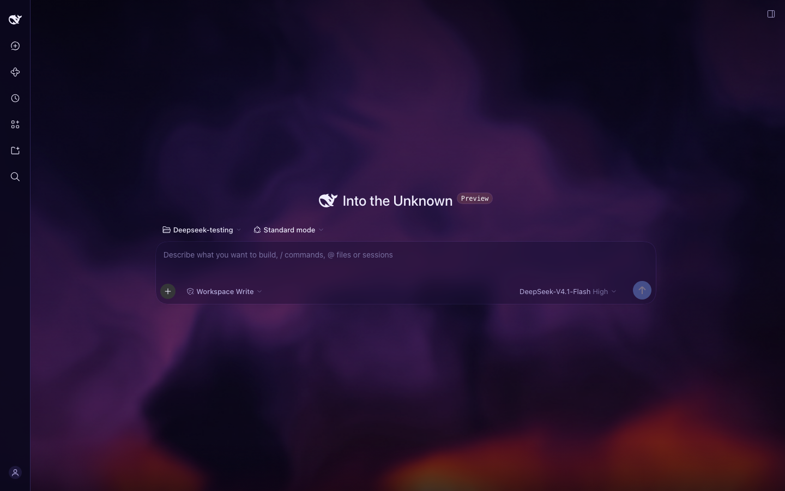
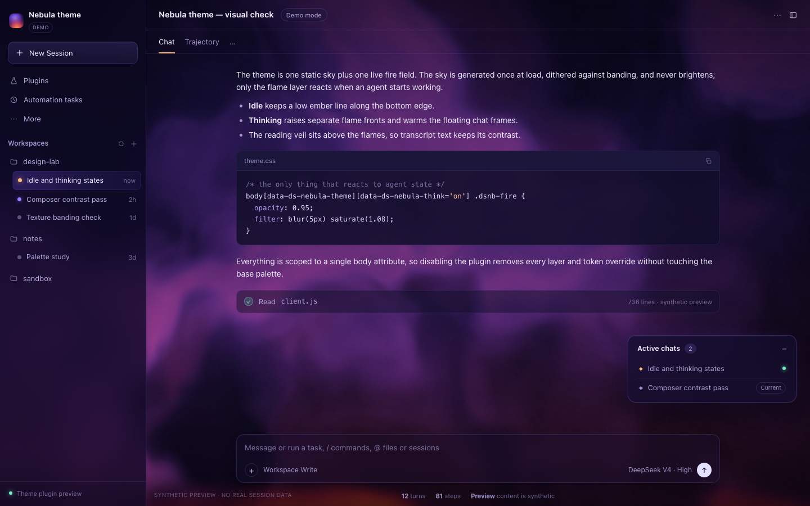
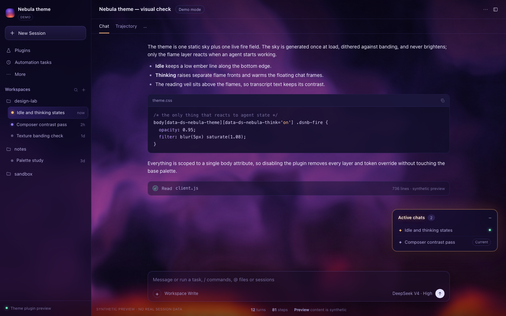

# Nebula theme for DeepSeek Harness

A client theme bundle for the DeepSeek Harness web UI: a filamented indigo-plum
night sky with a live fire field along the bottom edge. The fire stays a low
ember line while the harness is idle and rises into separate flame fronts while
any agent is thinking. The sky itself never brightens.


*A fresh chat with the sidebar collapsed: idle embers under the drifting sky.*


*Idle — a low ember line under a still, drifting sky.*


*Thinking — the flame fronts rise and the floating chats pick up the ember frame.*

The idle and thinking images are rendered from [`demo/index.html`](demo/index.html)
with synthetic content; no real session data is used. The first image is the live
client with the sidebar collapsed.

## What it does

- **Sky** — one generated texture (domain-warped fBm, dark dust lanes, a crimson
  underglow) that is drawn once, dithered against banding, and then left alone.
  It drifts slowly and never reacts to agent state.
- **Depth** — a second, larger copy of the sky drifts the other way and breathes
  gently, so the cloud structure shifts against itself instead of sliding as one
  flat image.
- **Fire** — a 256×112 flame field with per-cell cooling, wind that leans with
  height, and bilinear advection. Idle runs it at 12 fps as a short ember line;
  thinking runs it at 30 fps and raises the source. A 48×20 downsample of the
  same field is blurred into the sky as firelight.
- **Readability** — a dark reading veil sits above the flames and below the UI,
  so transcript text keeps its contrast. The composer becomes a glass slab so
  the flame base glows through it.
- **Palette** — a token layer overrides the active palette in both light and
  dark mode, so the theme keeps its night-sky identity whichever mode is set.
- **Motion safety** — drift and parallax stop under `prefers-reduced-motion`;
  the fire keeps a static warm field instead of animating.

The theme never reads chat content. It asks the Session service only whether
any session is currently running, then projects that onto one body attribute
(`data-ds-nebula-think`).

## Install

Requires a DeepSeek Harness build with the web client (`@deepseek-ai/dsh-web-app`).

```sh
git clone https://github.com/gioguarin/dsh-nebula-theme.git
dsh plugin --profile web add ./dsh-nebula-theme
dsh --profile web
```

Replace `web` with the profile you actually boot. The bundle is a local package
(`@local/nebula-theme`) and is not published to npm, so install it from the
checkout as shown.

To remove it:

```sh
dsh plugin --profile web remove @local/nebula-theme
```

## How it works

The package is a normal DSH bundle:

| File | Role |
|---|---|
| `package.json` | Declares `dsh.bundle` (this patch) and `dsh.client` (web client module) |
| `cordis.patch.yml` | Inserts the `nebula-theme` row |
| `index.js` | Host half; intentionally empty |
| `client.js` | The whole theme: token layer, CSS, sky generator, fire field, status bridge |
| `locale/*.json` | Theme name and description in eight locales |
| `icon.svg` | Theme icon |

At apply time the client half:

1. registers a palette override through `ctx.theme.overrideTokens`;
2. injects one scoped `<style>` block;
3. generates the sky texture on an idle callback and publishes it as a CSS
   custom property;
4. appends the parallax layer and the fire/glow canvases to `<body>`;
5. sets the `data-ds-nebula-theme` body attribute;
6. mounts a tiny bridge into `shell.overlay` that sets `data-ds-nebula-think`
   whenever any session is running.

Every effect returns a disposer, so disabling the plugin removes the style,
the canvases, the texture URL, and the attributes without touching the app.

## Develop

There is no build step and no runtime dependency beyond React (provided by the
host).

```sh
node scripts/capture-previews.mjs   # regenerate preview/*.png
```

The capture script drives headless Chrome over the DevTools protocol because
virtual-time capture does not advance `requestAnimationFrame`, which the fire
needs in order to ramp. It uses synthetic content only.

[`demo/index.html`](demo/index.html) runs the real `client.js` against a minimal
module-loader stub and a mock shell, so it doubles as a quick visual check. Add
`?thinking=1` to see the thinking state.

## Compatibility

Built and tested against DeepSeek Harness `0.2.x`. It relies on the public
client seams `ctx.theme.overrideTokens`, `ctx.slots`, and the
`shell.overlay` slot; it does not patch host files.

The floating-chats styling is optional. If the `@local/active-chats` plugin is
installed it picks up the space-glass frame and the ember thinking glow; if it
is not, those rules never match.

## License

[MIT](LICENSE)
